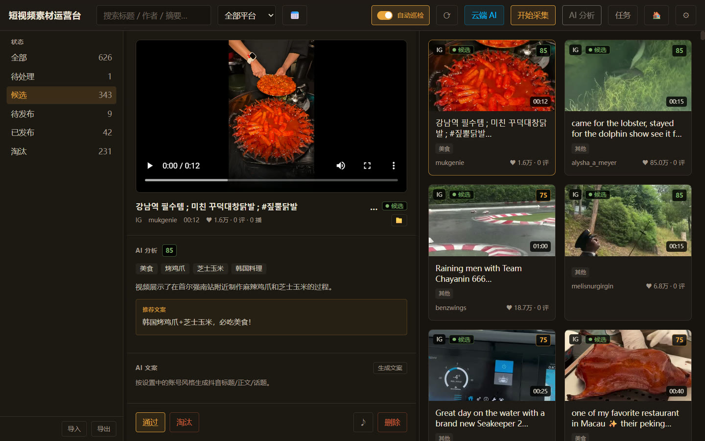
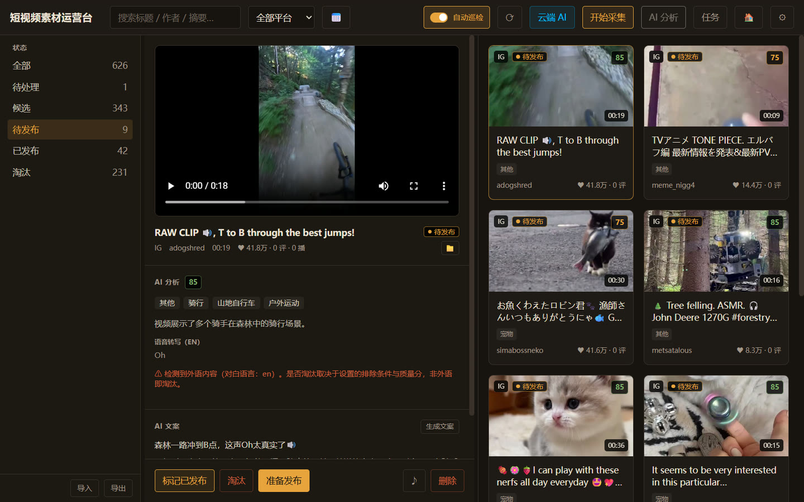
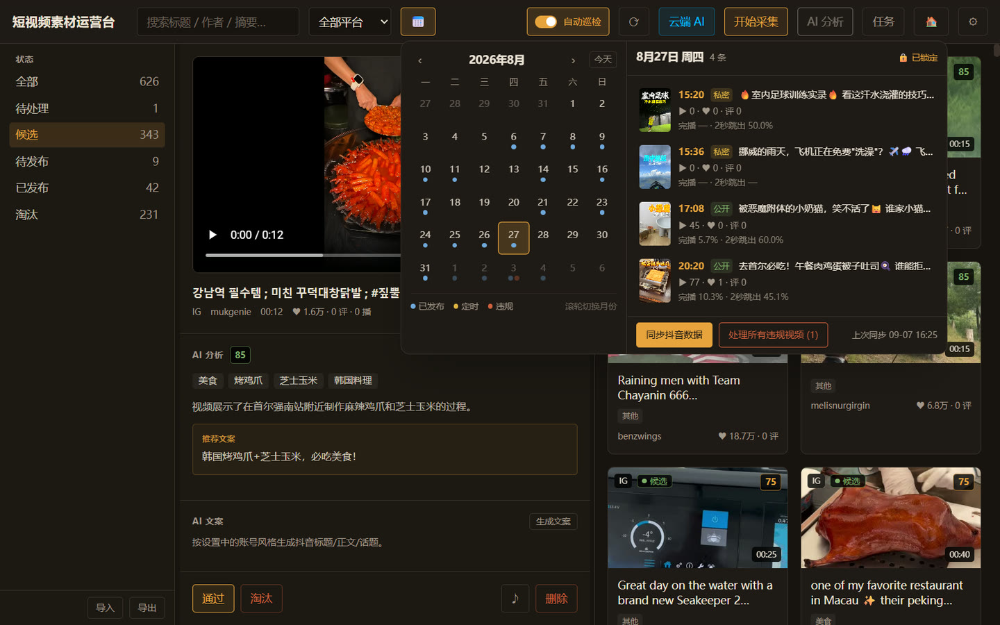
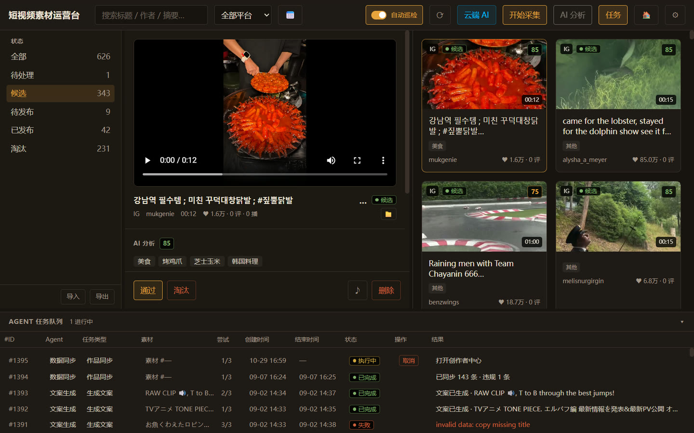
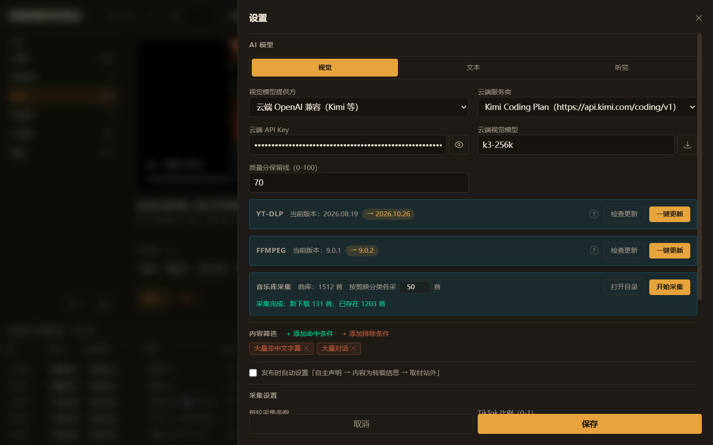
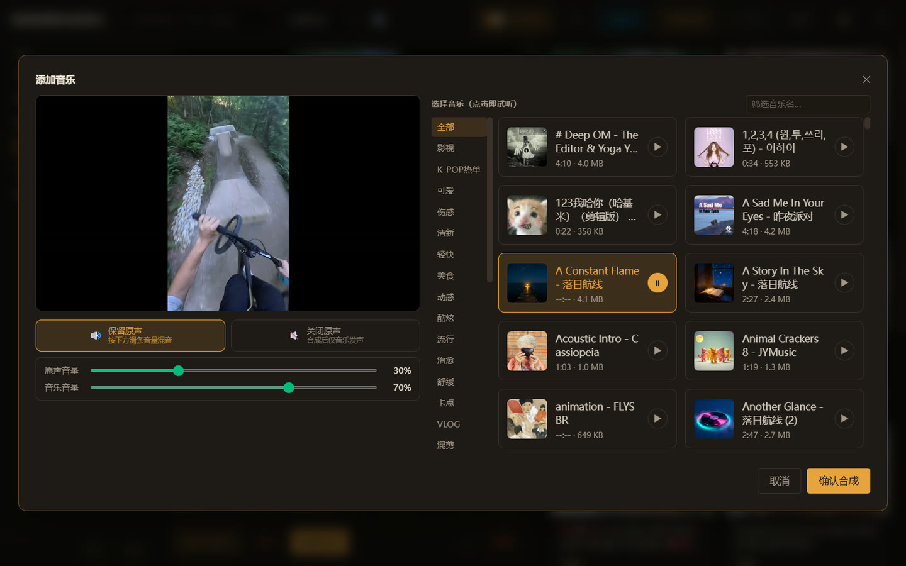

# build_douyin_acount

PC 端 AI 短视频运营助手 —— 从 TikTok / Instagram Reels 采集优质短视频，使用本地 AI 完成理解、分类、筛选与文案生成，辅助运营者发布到抖音。

> 这是一个**人机协作工具**，不是无人值守机器人。涉及账号登录、最终发布等高风险操作均保留人工确认环节。

## 界面预览

<table>
  <tr>
    <th align="center">素材库与 AI 分析</th>
    <th align="center">待发布素材与 AI 文案</th>
  </tr>
  <tr>
    <td><a href="docs/images/library.jpg"></a></td>
    <td><a href="docs/images/publish.jpg"></a></td>
  </tr>
  <tr>
    <th align="center">发布日历</th>
    <th align="center">Agent 任务队列</th>
  </tr>
  <tr>
    <td><a href="docs/images/calendar.jpg"></a></td>
    <td><a href="docs/images/tasks.jpg"></a></td>
  </tr>
  <tr>
    <th align="center">设置</th>
    <th align="center">添加音乐</th>
  </tr>
  <tr>
    <td><a href="docs/images/settings.jpg"></a></td>
    <td><a href="docs/images/music.jpg"></a></td>
  </tr>
</table>

## 当前进度

- [x] 第一阶段：需求分析与系统架构设计（2026-08-05）
- [x] 第二阶段：数据库 + 视频管理 + AI 分析 Pipeline（2026-08-05，41 个测试全绿）
- [x] 第三阶段：桌面 GUI + 视频浏览
- [x] 第四阶段：抖音发布辅助

## 文档索引

| 文档                                       | 内容                      |
| ---------------------------------------- | ----------------------- |
| [需求分析](docs/01-requirements-analysis.md) | 功能需求、补充约束、非功能需求、风险      |
| [系统架构](docs/02-architecture.md)          | 分层架构、Agent 设计、数据模型、核心流程 |
| [技术选型](docs/03-tech-stack.md)            | 技术栈与选型理由                |
| [目录结构](docs/04-directory-structure.md)   | 仓库结构与模块职责               |
| [阶段计划](docs/05-milestones.md)            | 分阶段实施计划与验收标准            |

## 技术栈概览

- 桌面端：Tauri 2 + Rust
- 前端：React 18 + TypeScript + TailwindCSS + Vite
- 数据库：SQLite
- 本地 AI：Ollama（Vision / LLM）+ Whisper（ASR）
- 视频处理：FFmpeg（程序内置，设置页可查看版本、一键安装/更新）
- 浏览器桥接：opencli（复用本人已登录的 Chrome）
- 下载：yt-dlp（程序内置，设置页可查看版本、一键更新）

## 运行方式

### 前置依赖（一次性）

- Rust stable + Node.js 18+ + pnpm
- [Ollama](https://ollama.com)：服务运行中，且已拉取 `qwen2.5vl:7b`（Vision）与 `qwen2.5:7b`（LLM）
- Chrome + opencli 浏览器扩展（采集与发布的浏览器桥接；扩展连接后 daemon 自动拉起）
- Whisper：`scripts/whisper-server/.venv`（faster-whisper Python 环境）

> FFmpeg 与 yt-dlp 均已程序内置（`storage/tools/`，随安装包分发，设置页可一键安装/更新），无需手动安装；`FFMPEG_PATH`/`FFPROBE_PATH` 环境变量仍可覆盖为自定义版本。

### 方式一：开发模式

```powershell
cd D:\Document\code\build_douyin_acount
pnpm install
pnpm tauri dev
```

首次编译较慢，之后约十几秒。注意：**关闭窗口仅隐藏到系统托盘**，后台任务（分析/发布/巡检）继续运行；从托盘菜单【退出】才真正结束程序。任务队列持久化在本地数据库，下次启动自动续跑未完成任务。

### 方式二：打包正式版（推荐日常使用）

```powershell
pnpm tauri build
```

产物为 `src-tauri\target\release\bundle\` 下的安装包，安装后从开始菜单启动，无需终端与开发环境。

### 每次使用前

- **Ollama**：AI 分析与文案生成都依赖它。顶栏有状态标签（绿色 = 已启动）；未启动时显示红色「Ollama 未启动」，**点击标签即可一键拉起**（免去手动 `ollama serve`）。未启动时分析/文案任务会报 `error sending request for url (http://localhost:11434/api/chat)`。
- 采集与发布需要 Chrome 的 opencli 扩展处于连接状态。

## 日常使用流程

1. 点击【开始采集】：TikTok / Instagram **串行**刷推荐流并下载（同一时刻只跑一个平台），任务队列实时显示进度；视频逐条入库并自动排队 AI 分析（需保持 Ollama 运行）。
2. 左侧栏按 候选 / 淘汰 / 待发布 与分类浏览，点击卡片查看详情（AI 淘汰的素材显示具体淘汰原因；手工淘汰显示「手工淘汰」）。
3. 候选视频点击【通过】→ 进入待发布，并按账号风格自动生成抖音文案（可在详情页重新生成）。
4. 点击【准备发布】→ 浏览器打开抖音创作后台，程序自动上传视频文件（注入页面文件组件，失败时回退人工选择），并自动填写标题 / 正文 / 话题、自动完成自主声明（内容为转载信息 / 取材站外）。
5. 核对无误后回到应用，在侧栏「发布中」列表对该任务点 ✓ 授权——程序代点一次页面上的【发布】按钮（定时作品为【定时发布】）；你也可以随时自己在浏览器点击，两种方式都会被自动检测并登记到发布日历。

筛选条件（命中 / 排除）、质量保留线、账号风格、采集配额（条数 / 平台比例 / 点赞上限）与各类路径均在应用【设置】页配置。

## 安全原则

1. 采集与发布通过 opencli 桥接**你本人已登录的 Chrome**（复用登录态），过程在可见的浏览器窗口中进行，可随时观察与中断。
2. 发布按钮仅在你对单个任务显式点勾授权后由程序代点一次（或你本人在浏览器点击），**不存在任何自动/定时/批量/无人值守的发布路径**。
3. 程序不另行存储账号密码，登录态完全由你本人的 Chrome 管理。
4. 点赞数超过 100 万的视频不采集。
