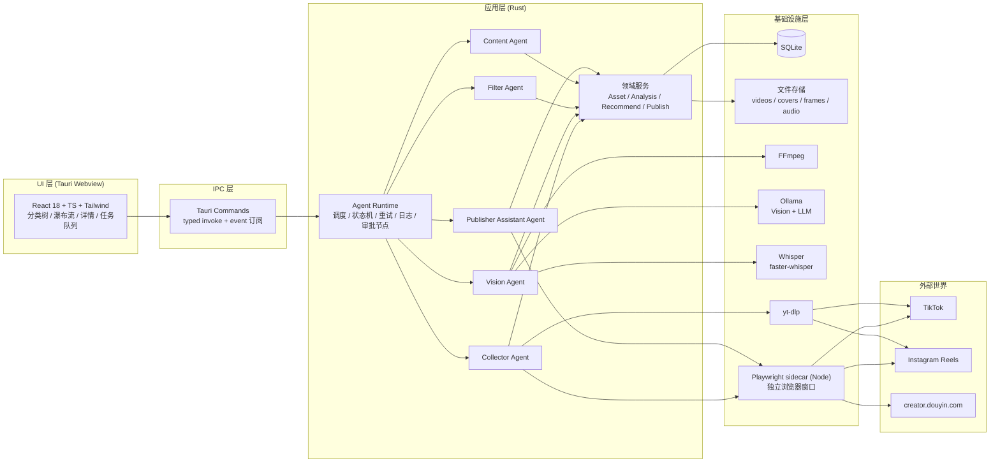
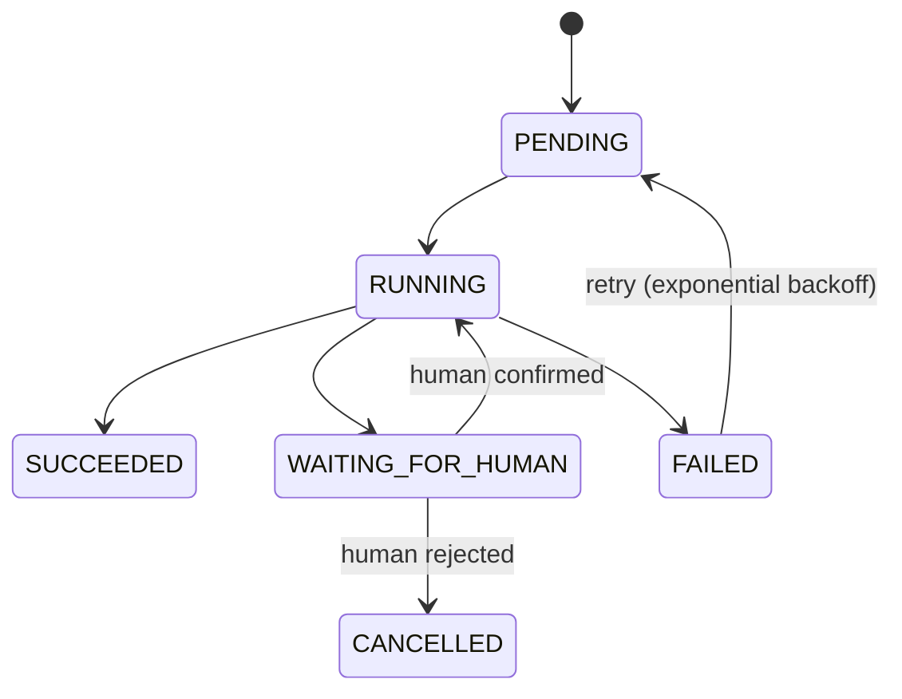
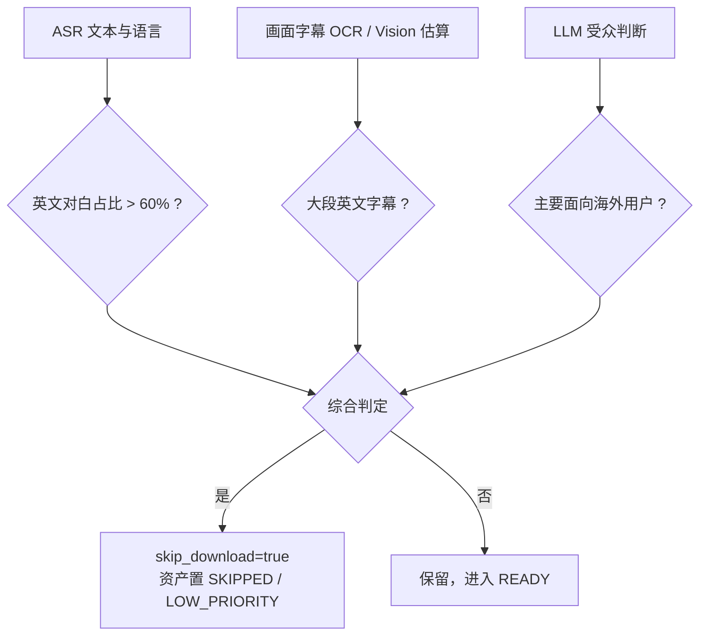
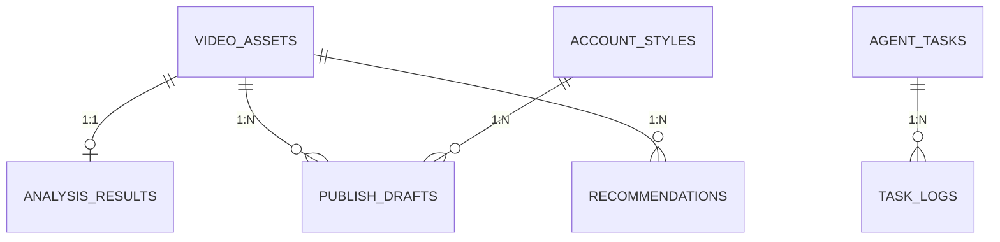

# 系统架构设计

## 1. 总体架构

采用 **Tauri 2 分层架构**：Rust 承载全部业务逻辑，React 仅做 UI，浏览器能力由独立 Playwright 进程提供，AI 能力由本地 Ollama / Whisper 进程提供。



## 2. 进程模型

| 进程 | 说明 |
| --- | --- |
| Tauri 主进程（Rust） | 唯一业务宿主；数据库、Agent、领域服务 |
| Playwright sidecar（Node） | 通过 JSON-RPC 提供"打开独立窗口、驱动页面、拦截网络响应"能力；**独立浏览器 Profile，绝不复用用户浏览器** |
| Ollama | 本地 LLM / Vision 推理服务（HTTP API） |
| Whisper | faster-whisper（Python 进程）或 whisper.cpp（Rust 绑定），ASR 推理 |
| yt-dlp | 视频下载（独立子进程） |
| FFmpeg | 抽帧、音频提取（独立子进程） |

## 3. Agent 化设计

### 3.1 Agent Runtime

所有任务统一入队、统一状态机、统一重试，UI 通过事件实时看到任务进度。



核心表 `agent_tasks`：

| 字段 | 说明 |
| --- | --- |
| id | 主键 |
| agent_name | collector / vision / filter / content / publisher |
| task_type | 如 `collect_batch`、`analyze_asset`、`generate_draft`、`prepare_publish` |
| payload_json | 任务入参 |
| status | PENDING / RUNNING / WAITING_FOR_HUMAN / SUCCEEDED / FAILED / CANCELLED |
| attempts | 已尝试次数 |
| max_attempts | 最大次数（默认 3） |
| next_retry_at | 指数退避后的重试时间 |
| human_required | 是否包含人工审批节点 |
| error | 最近一次错误摘要 |
| created_at / updated_at | 时间戳 |

Runtime 特性：

- **可恢复**：应用重启后从 `PENDING` / `RUNNING`（上次未完成）任务续跑。
- **并发控制**：同一 Agent 串行执行（本地 AI 资源有限），不同 Agent 之间可配置并发上限。
- **日志**：每个任务步骤写入 `task_logs`，同时镜像到 `storage/logs/`。
- **审批节点**：`WAITING_FOR_HUMAN` 状态通过事件推送到 GUI，用户确认后才继续。

### 3.2 Collector Agent（视频发现与下载）

```
collect_batch(payload: {target_total: 100, tiktok_ratio: 0.3})
  → 对 TikTok / Instagram 各启动独立浏览器窗口（独立 Profile）
  → 滚动推荐流，拦截网络响应中的视频元数据 JSON
  → 过滤：likes > 1_000_000 丢弃；dedup_key 去重
  → 满足配额后逐条下载（yt-dlp）
  → 每条写入 video_assets（status=NEW），并记录封面
```

**插件化**：

```rust
trait PlatformAdapter: Send + Sync {
    fn platform(&self) -> Platform;
    async fn discover_feed(&self, ctx: &CollectorContext) -> Result<Vec<FeedItem>>;
    async fn resolve_media(&self, item: &FeedItem) -> Result<MediaInfo>;
    async fn download(&self, media: &MediaInfo, dest: &Path) -> Result<DownloadResult>;
}
```

- `PlatformAdapterRegistry`：`HashMap<Platform, Box<dyn PlatformAdapter>>`，新增平台只增加一个 adapter。
- 元数据优先从**网络响应拦截**获取（比 DOM 解析稳定），DOM 解析作为兜底。
- 元数据字段：`source_platform / source_url / author / title / description / published_at / tags / likes / comments / plays / video_id`。
- 去重键：`{platform}:{video_id}`。

### 3.3 Vision Agent（视频理解）

```
analyze_asset(payload: {asset_id})
  → 状态置 ANALYZING
  → FFmpeg 抽帧：按时长均匀取 3~6 帧 → storage/frames/{asset_id}/
  → FFmpeg 提取 16kHz mono WAV → Whisper 转写 + 语言识别
  → Ollama Vision 模型逐帧分析（结构化输出：主体、场景、字幕文字、画面文字量）
  → LLM 综合（输入：帧摘要 + ASR 文本 + 元数据）
     输出严格 JSON：category / tags / quality_score / has_foreign_language /
                      has_large_amount_english_subtitle / summary / recommended_caption
  → 写入 analysis_results，资产状态置 READY（或 SKIPPED / LOW_PRIORITY，见 Filter）
```

工程要点：

- **JSON 约束**：LLM 使用 JSON Schema 提示 + 输出校验；解析失败自动重试 1 次，仍失败则任务 FAILED 并记录原始输出。
- **缓存**：已分析资产不重复分析；模型、提示词版本记录在结果中。
- **降级**：音频静音时跳过 ASR；无字幕视频 OCR 直接给"无字幕"。

### 3.4 Filter Agent（质量与英文过滤）

三层判定，结果合并：



- 判定结果写入 `analysis_results`（`has_foreign_language`、`has_large_amount_english_subtitle`）。
- `skip_download=true` 的资产**不再参与推荐**；`LOW_PRIORITY` 排最后。
- 规则阈值集中在 `resources/filter-rules.toml`，可调。

### 3.5 Content Agent（文案生成）

```
generate_draft(payload: {asset_id, style_id})
  → 读取 AnalysisResult + AccountStyle
  → LLM 按风格提示词生成：title / body / hashtags
  → 写入 publish_drafts（可多次生成，人工选用）
```

风格通过 `AccountStyle` 表配置，示例：搞笑、治愈、高级感、情绪价值。提示词模板在 `resources/prompts/content.md`。

### 3.6 Publisher Assistant Agent（发布辅助）

```
prepare_publish(payload: {asset_id, draft_id})
  → 校验本地文件存在、文案非空
  → 启动 Playwright 独立窗口（独立 Profile，持久化抖音登录态）
  → 打开 creator.douyin.com
  → 若未登录：状态 WAITING_FOR_HUMAN，UI 提示用户人工登录
  → 上传视频文件 → 填写标题 / 正文 / 话题标签（选择器来自 resources/selectors/douyin.json）
  → 表单填写完成 → 状态 WAITING_FOR_HUMAN（"等待人工发布"）
  → 用户核对后亲手点击【发布】→ 在 GUI 标记"已发布" → 资产置 PUBLISHED
```

**安全护栏（写入代码约束）**：

1. 代码库中不存在对发布按钮的自动 `click`。
2. 自动化只操作可识别的表单元素；识别失败立即停止并提示。
3. "已发布"标记由用户手动触发，且带二次确认。

## 4. 数据模型（SQLite）



### video_assets

| 字段 | 类型 | 说明 |
| --- | --- | --- |
| id | INTEGER PK | |
| dedup_key | TEXT UNIQUE | `{platform}:{video_id}` |
| file_path | TEXT | 本地视频路径 |
| cover_path | TEXT | 封面图路径 |
| source_platform | TEXT | tiktok / instagram |
| source_url | TEXT | 来源链接 |
| author | TEXT | 作者 |
| title | TEXT | 标题 |
| description | TEXT | 完整描述 |
| published_at | TEXT | 发布时间 |
| tags_json | TEXT | 平台标签 JSON |
| likes / comments / plays | INTEGER | 互动数据 |
| duration_ms | INTEGER | 时长 |
| status | TEXT | NEW/ANALYZING/READY/SELECTED/PUBLISHED/SKIPPED/LOW_PRIORITY/DOWNLOAD_FAILED |
| is_favorite | INTEGER | 收藏 |
| created_at / updated_at | TEXT | |

### analysis_results

| 字段 | 类型 |
| --- | --- |
| id / asset_id (UNIQUE FK) | INTEGER |
| category | TEXT |
| tags_json | TEXT |
| quality_score | INTEGER |
| has_foreign_language | INTEGER |
| has_large_amount_english_subtitle | INTEGER |
| summary / recommended_caption | TEXT |
| asr_text / asr_language | TEXT |
| frame_paths_json | TEXT |
| model_name / prompt_version | TEXT |
| created_at | TEXT |

### account_styles

`id, name, description, tone_prompt, created_at`

### publish_drafts

`id, asset_id FK, style_id FK, title, body, hashtags_json, status, created_at`

### recommendations

`id, batch_id, asset_id FK, category, rank, reason, score, created_at`

## 5. 核心流程

### 5.1 一次完整采集-分析-推荐周期

```
1. 用户在 GUI 点击【开始采集】
2. Runtime 创建 collect_batch 任务（Collector Agent）
3. Collector 按 30/70 比例刷两个平台的推荐流，采满 100 条
4. 每条资产入库（NEW）→ 自动入队 analyze_asset（Vision Agent）
5. Vision Agent 逐条分析 → Filter 判定 → 资产进入 READY / SKIPPED / LOW_PRIORITY
6. 全部完成后 Runtime 触发 generate_recommendations（每类 Top N，含理由）
7. GUI 展示"每个标签的推荐视频"，用户勾选、收藏、删除
```

### 5.2 发布周期

```
1. 用户勾选视频 → Content Agent 生成文案（可换风格重生成）
2. 用户点击【准备发布】→ Publisher Agent 执行至"表单已填完" → WAITING_FOR_HUMAN
3. 独立窗口停在发布页 → 用户人工核对 → 亲手点击【发布】
4. 用户回 GUI 标记已发布 → PUBLISHED
```

## 6. 推荐算法（每个标签推荐若干）

目标：从 `READY` 资产中，为每个分类选出**少量（如 3~5 条）最值得发布的视频**，并给出可解释的推荐理由。

采用**确定性加权打分 + LLM 风格加成**：

```
score = w1 * quality_score（AI 质量分）
      + w2 * engagement_rate（likes/plays，上限内）
      + w3 * freshness（发布时间衰减）
      + w4 * style_match（与账号风格匹配度，由 Content/LLM 评估）
      - w5 * content_overlap（同批内去重，避免同质内容扎堆）
      - penalty(has_foreign_language / 大段英文字幕)
```

执行：

1. 每个分类内部按加权分排序。
2. 多样性约束：同一作者最多 1 条进 Top N；标签重叠度高的候选降权。
3. LLM 增强（可选）：将候选摘要打包给 LLM 精排并生成推荐理由（`reason` 字段）。
4. 输出写入 `recommendations`，GUI 在分类下以"推荐"角标展示。

> 选择加权算法而非纯 LLM：结果**确定、可复现、可解释**；LLM 只负责风格匹配与文案层面的增强。

## 7. 采集与发布的浏览器隔离

用户当前浏览器是工作环境，工具**绝不借用**。因此：

- 采集器与发布器都使用 **Playwright 启动独立 Chromium 实例**，带独立 `user-data-dir`（`storage/browser-profiles/collector`、`storage/browser-profiles/publisher`）。
- 窗口独立可见，方便用户随时观察采集/发布过程。
- 登录态只在独立 Profile 中持久化，与用户日常浏览器完全隔离。
