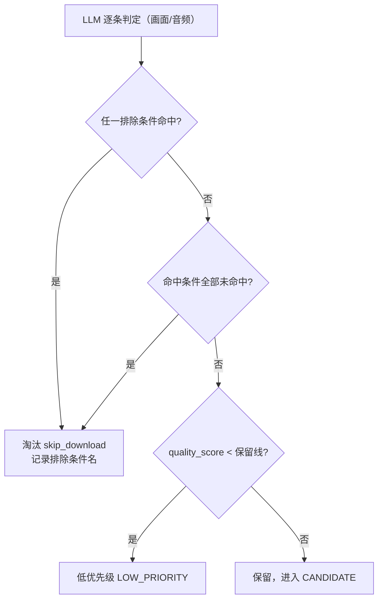

# 自定义筛选条件（命中条件 / 排除条件）实现计划

> **面向 AI 代理的工作者：** 必需子技能：使用 superpowers:subagent-driven-development（推荐）或 superpowers:executing-plans 逐任务实现此计划。步骤使用复选框（`- [ ]`）语法来跟踪进度。

**目标：** 把「命中条件 / 排除条件」做成设置页可配置的筛选列表，由 LLM 在分析阶段逐条判定并入库；同时删除两条内置英文过滤规则（大量英文字幕、英文主导对白），质量分规则保留。

**架构：** 设置里新增 `hit_conditions` / `exclude_conditions` 字符串列表（空 = 不限制），经 `AppSettings` 注入 `FilterRules`；分析 prompt 动态携带条件清单，LLM 在 `conditions` 数组逐条输出 `{name, hit, basis}`，存入 `analysis_results.condition_results_json`；`FilterAgent::evaluate` 按「排除任一命中 → 淘汰 → 命中全部未命中 → 淘汰 → 质量分」顺序判定，返回 `FilterDecision { verdict, reason }`。

**技术栈：** Rust（rusqlite / serde / tokio）、Tauri、React + TypeScript + Vite + Vitest、Ollama。

**规格：** `docs/superpowers/specs/2026-08-06-filter-conditions-design.md`

---

## 文件结构

| 文件 | 职责 | 变更 |
| --- | --- | --- |
| `src-tauri/src/domain/analysis.rs` | 定义 `ConditionVerdict`；`AnalysisResult` / `NewAnalysis` 增加 `condition_results` | 修改 |
| `src-tauri/src/db/migrations.rs` | `analysis_results` 建表语句增加新列 | 修改 |
| `src-tauri/src/db/mod.rs` | 启动时幂等补列 `condition_results_json`（旧库） | 修改 |
| `src-tauri/src/db/repos/analyses.rs` | 新列读写 | 修改 |
| `src-tauri/src/analysis/llm.rs` | `AnalysisJson` 加 `conditions`；解析容错；`OllamaLlm` 动态拼条件段 | 修改 |
| `src-tauri/src/analysis/pipeline.rs` | `SynthesisRequest` 加条件字段；`analyze` 接收条件参数；`NewAnalysis` 填 `condition_results` | 修改 |
| `src-tauri/src/agents/filter.rs` | 删除英文规则与 `english_word_ratio`；`FilterRules` 换字段；`evaluate` 返回 `FilterDecision` | 修改 |
| `src-tauri/src/agents/vision.rs` | 使用 `FilterDecision`；成功输出 `reason`；`analyze` 传条件 | 修改 |
| `src-tauri/src/settings.rs` | 删 `english_ratio_threshold`；加 `hit_conditions` / `exclude_conditions`（`#[serde(default)]`） | 修改 |
| `src-tauri/src/state.rs` | `FilterRules` 从设置注入条件列表 | 修改 |
| `resources/prompts/vision-synthesize.md` | 增加 conditions 输出说明 | 修改 |
| `frontend/src/api/types.ts` | `AppSettings` 类型同步 | 修改 |
| `frontend/src/components/settings/SettingsDrawer.tsx` | 删英文阈值输入；加两个条件列表编辑区 | 修改 |
| `frontend/src/lib/format.ts` / `format.test.ts` | `cleanConditions` 辅助 + 测试 | 修改 |
| `docs/02-architecture.md` | 3.4 节筛选规则描述更新 | 修改 |
| `src-tauri/tests/agents_test.rs` | 过滤规则矩阵重写 | 修改 |
| `src-tauri/tests/settings_test.rs` | 设置字段断言更新 | 修改 |
| `src-tauri/tests/analysis_pipeline_test.rs` | parse conditions / 条件流转测试 | 修改 |
| `src-tauri/tests/db_repos_test.rs` | condition_results 往返测试 | 修改 |
| `src-tauri/tests/db_counts_test.rs`、`content_test.rs` | `NewAnalysis` 构造补字段 | 修改 |

所有命令在仓库根 `D:\Document\code\build_douyin_acount` 下执行；后端命令加 `-p` 不需要，直接 `cd src-tauri`。

---

## 任务 1：领域模型与数据库（condition_results 全链路）

**文件：**
- 修改：`src-tauri/src/domain/analysis.rs`
- 修改：`src-tauri/src/db/migrations.rs`
- 修改：`src-tauri/src/db/mod.rs`
- 修改：`src-tauri/src/db/repos/analyses.rs`
- 修改：`src-tauri/src/analysis/pipeline.rs`（仅 NewAnalysis 构造补占位字段）
- 修改：`src-tauri/src/agents/filter.rs`（仅 Agent::run 中 NewAnalysis 构造补字段）
- 修改：`src-tauri/tests/agents_test.rs`、`src-tauri/tests/db_counts_test.rs`、`src-tauri/tests/content_test.rs`、`src-tauri/tests/db_repos_test.rs`

- [ ] **步骤 1.1：写失败测试（condition_results 往返）**

在 `src-tauri/tests/db_repos_test.rs` 中，把 import 行改为：

```rust
use build_douyin_acount_lib::domain::analysis::{ConditionVerdict, NewAnalysis};
```

并在 `analysis_upsert_updates_existing_row` 之后追加：

```rust
#[test]
fn analysis_condition_results_roundtrip() {
    let db = test_db();
    let assets = AssetsRepo::new(&db);
    let analyses = AnalysesRepo::new(&db);
    let id = assets.insert(sample_asset("cond")).expect("insert");
    let verdicts = vec![
        ConditionVerdict { name: "宠物".to_string(), hit: true, basis: "画面".to_string() },
        ConditionVerdict { name: "长中文对话".to_string(), hit: false, basis: "音频".to_string() },
    ];
    analyses
        .upsert(NewAnalysis {
            asset_id: id,
            category: Some("宠物".to_string()),
            tags: vec![],
            quality_score: Some(80),
            has_foreign_language: false,
            has_large_amount_english_subtitle: false,
            summary: None,
            recommended_caption: None,
            asr_text: None,
            asr_language: None,
            frame_paths: vec![],
            model_name: None,
            prompt_version: None,
            condition_results: verdicts.clone(),
        })
        .expect("upsert");
    let row = analyses.get_by_asset(id).expect("get").expect("some");
    assert_eq!(row.condition_results, verdicts);
}
```

- [ ] **步骤 1.2：运行测试确认失败**

运行：`cd src-tauri; cargo test analysis_condition_results_roundtrip`

预期：编译失败，报错 `missing field 'condition_results' in initializer of 'NewAnalysis'`（以及多处同类编译错误），并报 `ConditionVerdict` 未定义。

- [ ] **步骤 1.3：实现领域结构**

在 `src-tauri/src/domain/analysis.rs` 的 `FilterVerdict` 之前新增：

```rust
/// 单条筛选条件的 LLM 判定结果。
#[derive(Debug, Clone, Serialize, Deserialize, PartialEq)]
pub struct ConditionVerdict {
    pub name: String,
    pub hit: bool,
    pub basis: String,
}
```

在 `AnalysisResult` 中 `prompt_version` 之后新增：

```rust
    #[serde(default)]
    pub condition_results: Vec<ConditionVerdict>,
```

在 `NewAnalysis` 中 `prompt_version` 之后新增：

```rust
    #[serde(default)]
    pub condition_results: Vec<ConditionVerdict>,
```

- [ ] **步骤 1.4：实现迁移（新库建列 + 旧库幂等补列）**

在 `src-tauri/src/db/migrations.rs` 的 `analysis_results` 建表语句中，`prompt_version TEXT,` 与 `created_at` 之间插入：

```sql
  condition_results_json TEXT NOT NULL DEFAULT '[]',
```

在 `src-tauri/src/db/mod.rs` 中新增函数并调用。在 `Database::open` 内 `conn.execute_batch(migrations::MIGRATIONS)?;` 之后加一行：

```rust
ensure_analysis_conditions_column(&conn)?;
```

在 `seed_account_styles` 函数之前新增：

```rust
/// 旧库升级：analysis_results 缺 condition_results_json 列时补上（幂等，每次启动安全）。
fn ensure_analysis_conditions_column(conn: &Connection) -> Result<(), DomainError> {
    let mut stmt = conn.prepare("PRAGMA table_info(analysis_results)")?;
    let cols: Vec<String> = stmt
        .query_map([], |r| r.get::<_, String>(1))?
        .collect::<Result<_, _>>()?;
    if !cols.iter().any(|c| c == "condition_results_json") {
        conn.execute_batch(
            "ALTER TABLE analysis_results ADD COLUMN condition_results_json TEXT NOT NULL DEFAULT '[]'",
        )?;
    }
    Ok(())
}
```

- [ ] **步骤 1.5：实现 repo 读写**

在 `src-tauri/src/db/repos/analyses.rs`：

`row_to_analysis` 中 `created_at: row.get(14)?` 之后新增：

```rust
        condition_results: serde_json::from_str(&row.get::<_, String>(15)?).unwrap_or_default(),
```

`upsert` 的 INSERT 列清单改为：

```rust
        "INSERT INTO analysis_results
            (asset_id, category, tags_json, quality_score, has_foreign_language,
             has_large_amount_english_subtitle, summary, recommended_caption,
             asr_text, asr_language, frame_paths_json, model_name, prompt_version,
             condition_results_json)
         VALUES (?1,?2,?3,?4,?5,?6,?7,?8,?9,?10,?11,?12,?13,?14)
         ON CONFLICT(asset_id) DO UPDATE SET
            category = excluded.category,
            tags_json = excluded.tags_json,
            quality_score = excluded.quality_score,
            has_foreign_language = excluded.has_foreign_language,
            has_large_amount_english_subtitle = excluded.has_large_amount_english_subtitle,
            summary = excluded.summary,
            recommended_caption = excluded.recommended_caption,
            asr_text = excluded.asr_text,
            asr_language = excluded.asr_language,
            frame_paths_json = excluded.frame_paths_json,
            model_name = excluded.model_name,
            prompt_version = excluded.prompt_version,
            condition_results_json = excluded.condition_results_json",
```

`params![...]` 末尾 `input.prompt_version,` 之后新增：

```rust
                serde_json::to_string(&input.condition_results)?,
```

- [ ] **步骤 1.6：更新所有 NewAnalysis 构造点（补 `condition_results` 占位）**

1. `src-tauri/src/analysis/pipeline.rs` 的 `NewAnalysis { ... }` 中 `prompt_version: Some(env!("CARGO_PKG_VERSION").to_string()),` 之后加 `condition_results: vec![],`（任务 3 会替换为真实值）。
2. `src-tauri/src/agents/filter.rs` 的 `Agent::run` 中 `NewAnalysis { ... }` 末尾加 `condition_results: analysis.condition_results,`。
3. `src-tauri/tests/agents_test.rs` 的 `sample_analysis`：`prompt_version: Some("v1".to_string()),` 之后加 `condition_results: vec![],`。
4. `src-tauri/tests/db_counts_test.rs` 的 `NewAnalysis { ... }`：`prompt_version: None,` 之后加 `condition_results: vec![],`。
5. `src-tauri/tests/content_test.rs` 的 `attach_analysis` 中 `NewAnalysis { ... }`：`prompt_version: Some("t".to_string()),` 之后加 `condition_results: vec![],`。
6. `src-tauri/tests/db_repos_test.rs` 的两处 `NewAnalysis { ... }`（`asset_list_filters_by_status_and_category` 与 `asset_delete_cascades_analysis`）：`prompt_version` 之后各加 `condition_results: vec![],`。

- [ ] **步骤 1.7：验证**

运行：`cd src-tauri; cargo test`

预期：全部测试通过（含新 `analysis_condition_results_roundtrip`）。

运行：`cd src-tauri; cargo clippy --all-targets`

预期：零警告。

- [ ] **步骤 1.8：Commit**

```bash
git add src-tauri/src/domain/analysis.rs src-tauri/src/db/migrations.rs src-tauri/src/db/mod.rs src-tauri/src/db/repos/analyses.rs src-tauri/src/analysis/pipeline.rs src-tauri/src/agents/filter.rs src-tauri/tests/agents_test.rs src-tauri/tests/db_counts_test.rs src-tauri/tests/content_test.rs src-tauri/tests/db_repos_test.rs
git commit -m "feat(分析): 分析结果持久化逐条条件判定（condition_results）"
```

---

## 任务 2：设置模型 + 过滤规则改造 + 装配

**文件：**
- 修改：`src-tauri/src/settings.rs`
- 修改：`src-tauri/src/state.rs`
- 修改：`src-tauri/src/agents/filter.rs`
- 修改：`src-tauri/src/agents/vision.rs`
- 修改：`src-tauri/tests/settings_test.rs`
- 修改：`src-tauri/tests/agents_test.rs`

- [ ] **步骤 2.1：重写 agents_test.rs 过滤测试（先写失败测试）**

把 `use build_douyin_acount_lib::agents::filter::{english_word_ratio, FilterAgent, FilterRules};` 改为：

```rust
use build_douyin_acount_lib::agents::filter::{FilterAgent, FilterRules};
```

并把文件中原有的 `use build_douyin_acount_lib::domain::analysis::{FilterVerdict, NewAnalysis};` 改为：

```rust
use build_douyin_acount_lib::domain::analysis::{ConditionVerdict, FilterVerdict, NewAnalysis};
```

删除 `english_word_ratio_counts_latin_words`、`filter_skips_large_english_subtitles`、`filter_skips_english_dominated_speech` 三个测试，并把其余 Filter 测试替换为：

```rust
#[test]
fn filter_english_content_no_longer_auto_eliminated() {
    let rules = FilterRules::default();
    let a = sample_analysis(1);
    let with_sub = NewAnalysis {
        has_large_amount_english_subtitle: true,
        ..a.clone()
    };
    assert_eq!(FilterAgent::evaluate(&with_sub, &rules).expect("ok").verdict, FilterVerdict::Keep);
    let en = NewAnalysis {
        has_foreign_language: true,
        asr_language: Some("en".to_string()),
        asr_text: Some("welcome to my channel today we cook".to_string()),
        ..a
    };
    assert_eq!(FilterAgent::evaluate(&en, &rules).expect("ok").verdict, FilterVerdict::Keep);
}

#[test]
fn filter_hit_any_keeps() {
    let rules = FilterRules {
        hit_conditions: vec!["宠物".to_string(), "风景".to_string()],
        ..FilterRules::default()
    };
    let a = NewAnalysis {
        condition_results: vec![
            ConditionVerdict { name: "宠物".to_string(), hit: true, basis: "画面".to_string() },
            ConditionVerdict { name: "风景".to_string(), hit: false, basis: "画面".to_string() },
        ],
        ..sample_analysis(1)
    };
    assert_eq!(FilterAgent::evaluate(&a, &rules).expect("ok").verdict, FilterVerdict::Keep);
}

#[test]
fn filter_no_hit_eliminates_with_reason() {
    let rules = FilterRules {
        hit_conditions: vec!["宠物".to_string(), "风景".to_string()],
        ..FilterRules::default()
    };
    let a = NewAnalysis {
        condition_results: vec![
            ConditionVerdict { name: "宠物".to_string(), hit: false, basis: "画面".to_string() },
            ConditionVerdict { name: "风景".to_string(), hit: false, basis: "画面".to_string() },
        ],
        ..sample_analysis(1)
    };
    let d = FilterAgent::evaluate(&a, &rules).expect("ok");
    assert_eq!(d.verdict, FilterVerdict::SkipDownload);
    assert_eq!(d.reason.as_deref(), Some("no_hit_condition"));
}

#[test]
fn filter_exclude_any_eliminates_with_reason() {
    let rules = FilterRules {
        exclude_conditions: vec!["色情".to_string()],
        ..FilterRules::default()
    };
    let a = NewAnalysis {
        condition_results: vec![
            ConditionVerdict { name: "色情".to_string(), hit: true, basis: "画面".to_string() },
        ],
        ..sample_analysis(1)
    };
    let d = FilterAgent::evaluate(&a, &rules).expect("ok");
    assert_eq!(d.verdict, FilterVerdict::SkipDownload);
    assert_eq!(d.reason.as_deref(), Some("excluded_by_condition: 色情"));
}

#[test]
fn filter_exclude_wins_over_hit() {
    let rules = FilterRules {
        hit_conditions: vec!["宠物".to_string()],
        exclude_conditions: vec!["色情".to_string()],
        ..FilterRules::default()
    };
    let a = NewAnalysis {
        condition_results: vec![
            ConditionVerdict { name: "宠物".to_string(), hit: true, basis: "画面".to_string() },
            ConditionVerdict { name: "色情".to_string(), hit: true, basis: "画面".to_string() },
        ],
        ..sample_analysis(1)
    };
    assert_eq!(FilterAgent::evaluate(&a, &rules).expect("ok").verdict, FilterVerdict::SkipDownload);
}

#[test]
fn filter_ignores_blank_conditions() {
    let rules = FilterRules {
        hit_conditions: vec!["  ".to_string(), "宠物".to_string()],
        ..FilterRules::default()
    };
    let a = NewAnalysis {
        condition_results: vec![
            ConditionVerdict { name: "宠物".to_string(), hit: true, basis: "画面".to_string() },
        ],
        ..sample_analysis(1)
    };
    assert_eq!(FilterAgent::evaluate(&a, &rules).expect("ok").verdict, FilterVerdict::Keep);
}

#[test]
fn filter_legacy_analysis_without_verdicts_ignores_conditions() {
    let rules = FilterRules {
        hit_conditions: vec!["宠物".to_string()],
        exclude_conditions: vec!["色情".to_string()],
        ..FilterRules::default()
    };
    assert_eq!(FilterAgent::evaluate(&sample_analysis(1), &rules).expect("ok").verdict, FilterVerdict::Keep);
}

#[test]
fn filter_unjudged_hit_condition_skips_hit_layer() {
    let rules = FilterRules {
        hit_conditions: vec!["宠物".to_string(), "风景".to_string()],
        ..FilterRules::default()
    };
    let a = NewAnalysis {
        condition_results: vec![
            ConditionVerdict { name: "宠物".to_string(), hit: false, basis: "画面".to_string() },
        ],
        ..sample_analysis(1)
    };
    assert_eq!(FilterAgent::evaluate(&a, &rules).expect("ok").verdict, FilterVerdict::Keep);
}

#[test]
fn filter_unjudged_exclude_condition_does_not_exclude() {
    let rules = FilterRules {
        exclude_conditions: vec!["色情".to_string()],
        ..FilterRules::default()
    };
    let a = NewAnalysis {
        condition_results: vec![
            ConditionVerdict { name: "长中文对话".to_string(), hit: true, basis: "音频".to_string() },
        ],
        ..sample_analysis(1)
    };
    assert_eq!(FilterAgent::evaluate(&a, &rules).expect("ok").verdict, FilterVerdict::Keep);
}

#[test]
fn filter_marks_low_quality_as_low_priority() {
    let rules = FilterRules::default();
    let a = NewAnalysis {
        quality_score: Some(40),
        ..sample_analysis(1)
    };
    assert_eq!(FilterAgent::evaluate(&a, &rules).expect("ok").verdict, FilterVerdict::LowPriority);
}

#[test]
fn filter_keeps_clean_content() {
    let rules = FilterRules::default();
    assert_eq!(FilterAgent::evaluate(&sample_analysis(1), &rules).expect("ok").verdict, FilterVerdict::Keep);
}
```

把 `filter_agent_standalone_updates_status_from_db` 中 `let en = NewAnalysis { has_large_amount_english_subtitle: true, ..sample_analysis(asset_id) };` 改为：

```rust
    let en = NewAnalysis {
        condition_results: vec![
            ConditionVerdict { name: "色情".to_string(), hit: true, basis: "画面".to_string() },
        ],
        ..sample_analysis(asset_id)
    };
```

并把 `FilterAgent::new(FilterRules::default())` 改为：

```rust
    let agent = FilterAgent::new(FilterRules {
        exclude_conditions: vec!["色情".to_string()],
        ..FilterRules::default()
    });
```

- [ ] **步骤 2.2：更新 settings_test.rs（先写失败测试）**

1. `settings_defaults_when_nothing_stored` 中删除 `assert_eq!(settings.english_ratio_threshold, 0.6);`，并在 `assert_eq!(settings.quality_min_keep, 60);` 后加：

```rust
    assert!(settings.hit_conditions.is_empty());
    assert!(settings.exclude_conditions.is_empty());
```

2. `settings_roundtrip_persists_fields` 的 `custom` 字面量中删除 `english_ratio_threshold: 0.7,`，并在 `max_likes: 500_000,` 后加：

```rust
        hit_conditions: vec!["宠物".to_string(), "风景".to_string()],
        exclude_conditions: vec!["色情".to_string()],
```

3. 追加旧 JSON 兼容测试：

```rust
#[test]
fn settings_load_legacy_json_without_conditions_keeps_defaults() {
    let dir = tempfile::tempdir().expect("tempdir");
    let db = Database::open(&dir.path().join("test.db")).expect("open db");
    let legacy = r#"{"ollama_url":"http://localhost:11434","vision_model":"qwen2.5vl:7b","llm_model":"qwen2.5:7b","whisper_python":"p","whisper_script":"s","whisper_model":"base","english_ratio_threshold":0.6,"quality_min_keep":60,"node_bin":"node","publisher_script":"ps","publisher_browser":"chrome","collector_script":"cs","ytdlp_path":"yt-dlp","account_style":"治愈","batch_size":20,"tiktok_ratio":0.3,"instagram_ratio":0.7,"max_likes":1000000}"#;
    db.conn()
        .execute("INSERT INTO app_settings (key, value) VALUES ('app', ?1)", [legacy])
        .expect("insert legacy settings");
    let loaded = SettingsRepo::new(&db).load().expect("load");
    assert_eq!(loaded.quality_min_keep, 60, "existing field kept");
    assert!(loaded.hit_conditions.is_empty(), "missing field defaults to empty");
    assert!(loaded.exclude_conditions.is_empty(), "missing field defaults to empty");
}
```

- [ ] **步骤 2.3：运行测试确认失败**

运行：`cd src-tauri; cargo test`

预期：编译失败，报错集中在 `FilterRules` 无 `hit_conditions` / `exclude_conditions` 字段、`evaluate` 返回值无 `.verdict`、`AppSettings` 无对应字段。

- [ ] **步骤 2.4：实现 filter.rs**

把 `src-tauri/src/agents/filter.rs` 的 `FilterRules`、`english_word_ratio`、`FilterAgent::evaluate` 相关代码替换为：

```rust
use crate::agents::{Agent, AgentContext, AgentOutcome};
use crate::db::repos::analyses::AnalysesRepo;
use crate::db::repos::assets::AssetsRepo;
use crate::domain::analysis::{FilterVerdict, NewAnalysis};
use crate::domain::asset::AssetStatus;
use crate::domain::error::DomainError;
use crate::domain::task::AgentTask;

/// 过滤规则与自定义条件（由设置注入）。
#[derive(Debug, Clone)]
pub struct FilterRules {
    /// 低于该质量分进入低优先级。
    pub quality_min_keep: i64,
    /// 命中条件：任一命中即通过；空 = 不限制。
    pub hit_conditions: Vec<String>,
    /// 排除条件：任一命中即淘汰；空 = 不限制。
    pub exclude_conditions: Vec<String>,
}

impl Default for FilterRules {
    fn default() -> Self {
        Self {
            quality_min_keep: 60,
            hit_conditions: Vec::new(),
            exclude_conditions: Vec::new(),
        }
    }
}

/// 过滤判定结果：结论 + 淘汰原因（供任务日志排查）。
#[derive(Debug, Clone, PartialEq, Eq)]
pub struct FilterDecision {
    pub verdict: FilterVerdict,
    pub reason: Option<String>,
}

/// 查询某条件在分析判定中的命中情况（未判定返回 None）。
fn verdict_of(analysis: &NewAnalysis, name: &str) -> Option<bool> {
    analysis
        .condition_results
        .iter()
        .find(|v| v.name == name)
        .map(|v| v.hit)
}

/// 命中/排除条件与质量分的判定实现（纯逻辑，可独立测试）。
fn decide(analysis: &NewAnalysis, rules: &FilterRules) -> FilterDecision {
    // 排除条件层：任一已判定命中即淘汰（未判定条目不构成排除）。
    for c in rules
        .exclude_conditions
        .iter()
        .map(|s| s.trim())
        .filter(|s| !s.is_empty())
    {
        if verdict_of(analysis, c) == Some(true) {
            return FilterDecision {
                verdict: FilterVerdict::SkipDownload,
                reason: Some(format!("excluded_by_condition: {c}")),
            };
        }
    }
    // 命中条件层：全部已判定且全部未命中才淘汰；存在未判定条目则跳过本层，避免误杀。
    let hits: Vec<&str> = rules
        .hit_conditions
        .iter()
        .map(|s| s.trim())
        .filter(|s| !s.is_empty())
        .collect();
    if !hits.is_empty() && hits.iter().all(|c| verdict_of(analysis, c).is_some()) {
        if hits.iter().all(|c| verdict_of(analysis, c) == Some(false)) {
            return FilterDecision {
                verdict: FilterVerdict::SkipDownload,
                reason: Some("no_hit_condition".to_string()),
            };
        }
    }
    // 质量分规则（保留）。
    if let Some(score) = analysis.quality_score {
        if score < rules.quality_min_keep {
            return FilterDecision {
                verdict: FilterVerdict::LowPriority,
                reason: None,
            };
        }
    }
    FilterDecision { verdict: FilterVerdict::Keep, reason: None }
}

/// Filter Agent：过滤判定（纯逻辑，可独立测试）。
pub struct FilterAgent {
    rules: FilterRules,
}

impl FilterAgent {
    pub fn new(rules: FilterRules) -> Self {
        Self { rules }
    }

    pub fn evaluate(
        analysis: &NewAnalysis,
        rules: &FilterRules,
    ) -> Result<FilterDecision, DomainError> {
        Ok(decide(analysis, rules))
    }

    /// 将判定结果映射为资产状态：保留 -> 候选；其余（条件淘汰/质量不佳）统一淘汰。
    pub fn verdict_status(verdict: FilterVerdict) -> AssetStatus {
        match verdict {
            FilterVerdict::Keep => AssetStatus::Candidate,
            FilterVerdict::SkipDownload | FilterVerdict::LowPriority => AssetStatus::Eliminated,
        }
    }
}
```

`Agent::run` 中：

```rust
        let decision = Self::evaluate(&new_analysis, &self.rules)?;
        let status = Self::verdict_status(decision.verdict);
        AssetsRepo::new(ctx.db).update_status(asset_id, status)?;
        Ok(AgentOutcome::Succeeded(serde_json::json!({
            "asset_id": asset_id,
            "verdict": decision.verdict.as_str(),
            "status": status.to_string(),
            "reason": decision.reason,
        })))
```

（`new_analysis` 构造已含 `condition_results: analysis.condition_results`，来自任务 1。）

- [ ] **步骤 2.5：实现 settings.rs**

`src-tauri/src/settings.rs`：

1. 删除 `pub english_ratio_threshold: f64,` 字段。
2. 删除 `Default` 中的 `english_ratio_threshold: 0.6,`。
3. 在 `pub max_likes: i64,` 之后新增：

```rust
    /// 命中条件：任一命中即通过（空 = 不限制）。
    #[serde(default)]
    pub hit_conditions: Vec<String>,
    /// 排除条件：任一命中即淘汰（空 = 不限制）。
    #[serde(default)]
    pub exclude_conditions: Vec<String>,
```

4. 在 `Default` 的 `max_likes: 1_000_000,` 之后新增：

```rust
            hit_conditions: Vec::new(),
            exclude_conditions: Vec::new(),
```

- [ ] **步骤 2.6：更新 state.rs**

`src-tauri/src/state.rs` 的 `FilterRules { ... }` 构造改为：

```rust
            FilterRules {
                quality_min_keep: s.quality_min_keep,
                hit_conditions: s.hit_conditions.clone(),
                exclude_conditions: s.exclude_conditions.clone(),
            }
```

- [ ] **步骤 2.7：更新 vision.rs（FilterDecision + reason 输出）**

`src-tauri/src/agents/vision.rs` 中：

```rust
        let decision = FilterAgent::evaluate(&analysis, &self.rules)?;
        AnalysesRepo::new(ctx.db).upsert(analysis)?;
        let status = FilterAgent::verdict_status(decision.verdict);
        assets.update_status(asset_id, status)?;
        Ok(AgentOutcome::Succeeded(serde_json::json!({
            "asset_id": asset_id,
            "verdict": decision.verdict.as_str(),
            "status": status.to_string(),
            "reason": decision.reason,
        })))
```

- [ ] **步骤 2.8：验证**

运行：`cd src-tauri; cargo test`

预期：全部通过（含新过滤矩阵、设置测试、旧 JSON 兼容测试）。

运行：`cd src-tauri; cargo clippy --all-targets`

预期：零警告。

- [ ] **步骤 2.9：Commit**

```bash
git add src-tauri/src/settings.rs src-tauri/src/state.rs src-tauri/src/agents/filter.rs src-tauri/src/agents/vision.rs src-tauri/tests/settings_test.rs src-tauri/tests/agents_test.rs
git commit -m "feat(筛选): 命中/排除条件规则取代内置英文过滤，设置可配置"
```

---

## 任务 3：分析管线与 LLM 判定协议

**文件：**
- 修改：`src-tauri/src/analysis/llm.rs`
- 修改：`src-tauri/src/analysis/pipeline.rs`
- 修改：`src-tauri/src/agents/vision.rs`
- 修改：`resources/prompts/vision-synthesize.md`
- 修改：`src-tauri/tests/analysis_pipeline_test.rs`
- 修改：`src-tauri/tests/agents_test.rs`

- [ ] **步骤 3.1：写失败测试（parse conditions）**

在 `src-tauri/tests/analysis_pipeline_test.rs` 的 `parse_analysis_json_accepts_valid_output` 之后追加：

```rust
#[test]
fn parse_analysis_json_parses_conditions() {
    let raw = r#"{
        "category": "宠物",
        "tags": ["猫"],
        "quality_score": 85,
        "has_foreign_language": false,
        "has_large_amount_english_subtitle": false,
        "summary": "一只猫",
        "recommended_caption": "看猫",
        "conditions": [
            {"name": "宠物", "hit": true, "basis": "画面"},
            {"name": "长中文对话", "hit": false, "basis": "音频"}
        ]
    }"#;
    let parsed = parse_analysis_json(raw).expect("parse");
    assert_eq!(parsed.conditions.len(), 2);
    assert_eq!(parsed.conditions[0].name, "宠物");
    assert!(parsed.conditions[0].hit);
    assert_eq!(parsed.conditions[0].basis, "画面");
    assert!(!parsed.conditions[1].hit);
}

#[test]
fn parse_analysis_json_without_conditions_defaults_empty() {
    let raw = r#"{"category":"宠物","tags":[],"quality_score":80,"has_foreign_language":false,"has_large_amount_english_subtitle":false,"summary":"s","recommended_caption":"c"}"#;
    let parsed = parse_analysis_json(raw).expect("parse");
    assert!(parsed.conditions.is_empty());
}

#[test]
fn parse_analysis_json_tolerates_invalid_conditions() {
    let raw = r#"{"category":"宠物","tags":[],"quality_score":80,"has_foreign_language":false,"has_large_amount_english_subtitle":false,"summary":"s","recommended_caption":"c","conditions":"not-an-array"}"#;
    let parsed = parse_analysis_json(raw).expect("parse");
    assert!(parsed.conditions.is_empty());
}
```

同步把本文件 `FakeLlm` 的 `synthesize` 返回结构改为：

```rust
impl Llm for FakeLlm {
    fn synthesize(&self, req: SynthesisRequest) -> Result<AnalysisJson, DomainError> {
        Ok(AnalysisJson {
            category: "宠物".to_string(),
            tags: vec!["猫".to_string()],
            quality_score: 90,
            has_foreign_language: req.asr_language.as_deref() == Some("en"),
            has_large_amount_english_subtitle: req.frames.iter().any(|f| f.english_text),
            summary: req.frames.first().map(|f| f.description.clone()).unwrap_or_default(),
            recommended_caption: "测试文案".to_string(),
            conditions: req
                .hit_conditions
                .iter()
                .map(|c| build_douyin_acount_lib::domain::analysis::ConditionVerdict {
                    name: c.clone(),
                    hit: true,
                    basis: "画面".to_string(),
                })
                .collect(),
        })
    }
}
```

把两处 `pipeline.analyze(&video, &work, 42, None)` 改为带条件参数的调用（先写新签名会编译失败，属预期红）：

```rust
        .analyze(&video, &work, 42, None, &["宠物".to_string()], &[])
```

```rust
        .analyze(&video, &work, 42, None, &[], &[])
```

并在 `pipeline_orchestrates_frames_asr_vision_llm_into_analysis` 末尾追加断言：

```rust
    assert_eq!(result.condition_results.len(), 1);
    assert_eq!(result.condition_results[0].name, "宠物");
    assert!(result.condition_results[0].hit);
```

- [ ] **步骤 3.2：更新 agents_test.rs 的 FakeLlm**

`src-tauri/tests/agents_test.rs` 的 `FakeLlm::synthesize` 返回结构末尾加：

```rust
            conditions: vec![],
```

- [ ] **步骤 3.3：运行测试确认失败**

运行：`cd src-tauri; cargo test`

预期：编译失败，报 `AnalysisJson` 缺少 `conditions` 字段、`SynthesisRequest` 缺少条件字段、`analyze` 参数不匹配。

- [ ] **步骤 3.4：实现 llm.rs**

`src-tauri/src/analysis/llm.rs`：

1. import 行加 `use crate::domain::analysis::ConditionVerdict;`。
2. `AnalysisJson` 在 `recommended_caption` 之后加：

```rust
    #[serde(default)]
    pub conditions: Vec<ConditionVerdict>,
```

3. `parse_analysis_json` 中，在 `recommended_caption` 解析之后加：

```rust
    let conditions = value
        .get("conditions")
        .and_then(|v| v.as_array())
        .map(|arr| {
            arr.iter()
                .filter_map(|c| {
                    let name = c.get("name")?.as_str()?.trim();
                    if name.is_empty() {
                        return None;
                    }
                    Some(ConditionVerdict {
                        name: name.to_string(),
                        hit: c.get("hit").and_then(|v| v.as_bool()).unwrap_or(false),
                        basis: c.get("basis").and_then(|v| v.as_str()).unwrap_or("").to_string(),
                    })
                })
                .collect()
        })
        .unwrap_or_default();
```

并在返回的 `AnalysisJson { ... }` 字面量末尾加 `conditions,`。

4. `OllamaLlm::synthesize` 中，把 `let user = format!(...)` 改为先拼条件段再拼用户消息：

```rust
        let mut filter_lines = Vec::new();
        if !req.hit_conditions.is_empty() {
            filter_lines.push(format!("命中条件（至少命中其一）：{}", req.hit_conditions.join("、")));
        }
        if !req.exclude_conditions.is_empty() {
            filter_lines.push(format!("排除条件（任一命中即排除）：{}", req.exclude_conditions.join("、")));
        }
        let filter_section = if filter_lines.is_empty() {
            String::new()
        } else {
            format!(
                "\n\n筛选要求（请逐条判定是否命中，并把每条结果输出到 conditions 字段）：\n{}",
                filter_lines.join("\n")
            )
        };
        let user = format!(
            "视频元信息：\n标题：{}\n\n关键帧内容：\n{frames_text}\n\n音频转写（语言：{}）：\n{}{filter_section}",
            req.title.as_deref().unwrap_or("未知"),
            req.asr_language.as_deref().unwrap_or("unknown"),
            asr_text
        );
```

- [ ] **步骤 3.5：实现 pipeline.rs**

`src-tauri/src/analysis/pipeline.rs`：

1. `SynthesisRequest` 在 `title` 之后加：

```rust
    pub hit_conditions: Vec<String>,
    pub exclude_conditions: Vec<String>,
```

2. `analyze` 签名改为：

```rust
    pub fn analyze(
        &self,
        video: &Path,
        work_dir: &Path,
        asset_id: i64,
        title: Option<&str>,
        hit_conditions: &[String],
        exclude_conditions: &[String],
    ) -> Result<NewAnalysis, DomainError> {
```

3. `SynthesisRequest { ... }` 构造中 `title: title.map(|s| s.to_string()),` 之后加：

```rust
            hit_conditions: hit_conditions.to_vec(),
            exclude_conditions: exclude_conditions.to_vec(),
```

4. `NewAnalysis { ... }` 构造中把任务 1 的 `condition_results: vec![],` 改为：

```rust
            condition_results: json.conditions,
```

- [ ] **步骤 3.6：更新 vision.rs 的 analyze 调用**

`src-tauri/src/agents/vision.rs` 中：

```rust
        let analysis = self.pipeline.analyze(
            std::path::Path::new(&asset.file_path),
            &work_dir,
            asset_id,
            asset.title.as_deref(),
            &self.rules.hit_conditions,
            &self.rules.exclude_conditions,
        )?;
```

- [ ] **步骤 3.7：更新 prompt**

`resources/prompts/vision-synthesize.md` 整体替换为：

```markdown
你是一名短视频运营专家。根据给定视频的关键帧内容与音频转写，判断该视频是否适合搬运到中国抖音平台，并输出严格 JSON：
{
  "category": "宠物|生活|美食|手工|风景|其他",
  "tags": ["3到5个内容标签，中文"],
  "quality_score": 0到100的整数，
  "has_foreign_language": true或false（音频对白是否以英文为主），
  "has_large_amount_english_subtitle": true或false（画面是否包含大段英文字幕），
  "summary": "50字以内的中文内容摘要",
  "recommended_caption": "一句适合抖音的中文标题/文案",
  "conditions": [{"name":"条件原文","hit":true或false,"basis":"画面|音频|画面+音频"}]
}
要求：只输出 JSON，不要输出任何其他文字；quality_score 综合考虑画面质量、内容吸引力、是否适合国内用户。
若请求中提供了「筛选要求」清单，必须逐条判定每个条件是否命中：判定依据来自关键帧（画面）或音频转写（音频）；未提供筛选要求时，conditions 输出空数组 []。
```

- [ ] **步骤 3.8：验证**

运行：`cd src-tauri; cargo test`

预期：全部通过（含 parse conditions、条件经 pipeline 落入 NewAnalysis）。

运行：`cd src-tauri; cargo clippy --all-targets`

预期：零警告。

- [ ] **步骤 3.9：Commit**

```bash
git add src-tauri/src/analysis/llm.rs src-tauri/src/analysis/pipeline.rs src-tauri/src/agents/vision.rs resources/prompts/vision-synthesize.md src-tauri/tests/analysis_pipeline_test.rs src-tauri/tests/agents_test.rs
git commit -m "feat(分析): LLM 逐条判定命中/排除条件并随分析结果入库"
```

---

## 任务 4：前端设置 UI

**文件：**
- 修改：`frontend/src/api/types.ts`
- 修改：`frontend/src/components/settings/SettingsDrawer.tsx`
- 修改：`frontend/src/lib/format.ts`
- 修改：`frontend/src/lib/format.test.ts`

- [ ] **步骤 4.1：写 cleanConditions 失败测试**

在 `frontend/src/lib/format.test.ts` 的 import 行加 `cleanConditions`：

```ts
import { cleanConditions, formatCount, formatDuration, statusMeta } from "./format";
```

并在文件末尾追加：

```ts
describe("cleanConditions", () => {
  it("trims whitespace and drops empty rows", () => {
    expect(cleanConditions([" 宠物 ", "", "  ", "风景"])).toEqual(["宠物", "风景"]);
  });
});
```

- [ ] **步骤 4.2：运行前端测试确认失败**

运行：`cd frontend; pnpm test`

预期：`cleanConditions is not a function` / `Cannot find name 'cleanConditions'` 之类失败。

- [ ] **步骤 4.3：实现 cleanConditions**

在 `frontend/src/lib/format.ts` 末尾追加：

```ts
/** 筛选条件列表清洗：去首尾空白、丢弃空行。 */
export function cleanConditions(items: string[]): string[] {
  return items.map((s) => s.trim()).filter((s) => s.length > 0);
}
```

- [ ] **步骤 4.4：更新 types.ts**

`frontend/src/api/types.ts` 的 `AppSettings` 中：删除 `english_ratio_threshold: number;`，并在 `quality_min_keep: number;` 后加：

```ts
  hit_conditions: string[];
  exclude_conditions: string[];
```

- [ ] **步骤 4.5：更新 SettingsDrawer.tsx**

1. `EMPTY` 中删除 `english_ratio_threshold: 0.6,`，并在 `quality_min_keep: 60,` 后加：

```ts
  hit_conditions: [],
  exclude_conditions: [],
```

2. 在组件文件顶部（`EMPTY` 之后）新增可复用列表组件：

```tsx
const conditionField =
  "h-9 w-full rounded border border-line bg-ink px-2 text-sm text-paper focus:border-accent/60 focus:outline-none";

function ConditionList({
  title,
  placeholder,
  items,
  onChange,
}: {
  title: string;
  placeholder: string;
  items: string[];
  onChange: (items: string[]) => void;
}) {
  const update = (i: number, v: string) => {
    const next = items.slice();
    next[i] = v;
    onChange(next);
  };
  const remove = (i: number) => onChange(items.filter((_, idx) => idx !== i));
  return (
    <div className="border-t border-line pt-3">
      <p className="text-xs font-semibold uppercase tracking-wider text-mute">{title}</p>
      {items.length === 0 && <p className="mt-2 text-xs text-mute">不限制（空列表）</p>}
      <div className="mt-2 space-y-2">
        {items.map((item, i) => (
          <div key={i} className="flex gap-2">
            <input
              className={conditionField}
              value={item}
              placeholder={placeholder}
              onChange={(e) => update(i, e.target.value)}
            />
            <button
              type="button"
              onClick={() => remove(i)}
              className="h-9 shrink-0 rounded border border-line px-3 text-xs text-mute hover:text-bad"
            >
              删除
            </button>
          </div>
        ))}
      </div>
      <button
        type="button"
        onClick={() => onChange([...items, ""])}
        className="mt-2 text-xs text-accent hover:brightness-110"
      >
        + 添加条件
      </button>
    </div>
  );
}
```

3. 把「英文对白阈值 / 质量分保留线」的 `grid grid-cols-2` 块替换为单独的质量分输入（删除英文阈值那一半）：

```tsx
          <label className="block">
            <span className="text-xs text-mute">质量分保留线（0-100）</span>
            <input
              type="number"
              className={field}
              value={settings.quality_min_keep}
              onChange={(e) => set({ quality_min_keep: Number(e.target.value) })}
            />
          </label>
```

4. 在质量分输入之后、「采集设置」分区之前插入两个条件列表：

```tsx
          <ConditionList
            title="命中条件"
            placeholder="如：宠物、生活、风景、手工"
            items={settings.hit_conditions}
            onChange={(hit_conditions) => set({ hit_conditions })}
          />
          <ConditionList
            title="排除条件"
            placeholder="如：长中文对话、色情、性暗示"
            items={settings.exclude_conditions}
            onChange={(exclude_conditions) => set({ exclude_conditions })}
          />
```

5. `save` 改为保存前清洗空行：

```ts
  const save = async () => {
    try {
      const cleaned: AppSettings = {
        ...settings,
        hit_conditions: cleanConditions(settings.hit_conditions),
        exclude_conditions: cleanConditions(settings.exclude_conditions),
      };
      await api.updateSettings(cleaned);
      setSettings(cleaned);
      onClose();
    } catch (e) {
      setError(e instanceof Error ? e.message : String(e));
    }
  };
```

在文件顶部 import 加 `cleanConditions`：

```ts
import { cleanConditions } from "../../lib/format";
```

- [ ] **步骤 4.6：验证**

运行：`cd frontend; pnpm test`

预期：全部通过（含新增 cleanConditions 测试）。

运行：`cd frontend; pnpm build`

预期：构建成功、无 TS 错误。

- [ ] **步骤 4.7：Commit**

```bash
git add frontend/src/api/types.ts frontend/src/components/settings/SettingsDrawer.tsx frontend/src/lib/format.ts frontend/src/lib/format.test.ts
git commit -m "feat(设置): 命中/排除条件配置界面，移除英文阈值输入"
```

---

## 任务 5：全量回归与文档收尾

**文件：**
- 修改：`docs/02-architecture.md`

- [ ] **步骤 5.1：后端全量验证**

运行：`cd src-tauri; cargo test`

预期：全部通过。

运行：`cd src-tauri; cargo clippy --all-targets`

预期：零警告。

- [ ] **步骤 5.2：前端全量验证**

运行：`cd frontend; pnpm test`

预期：全部通过。

运行：`cd frontend; pnpm build`

预期：构建成功。

- [ ] **步骤 5.3：更新架构文档 3.4 节**

`docs/02-architecture.md` 的「### 3.4 Filter Agent（质量与英文过滤）」小节整体替换为：

````markdown
### 3.4 Filter Agent（质量与自定义条件过滤）

判定顺序：



- 「命中条件 / 排除条件」由用户在设置页配置（空列表 = 不限制），经 `AppSettings` 注入 `FilterRules`；LLM 对每条条件输出 `conditions: [{name, hit, basis}]`，判定依据为画面或音频。
- 逐条判定结果写入 `analysis_results.condition_results_json`；未配置条件或旧分析无判定数据时，条件层不生效。
- 内置英文规则（大段英文字幕、英文主导对白）已移除；需要过滤英文内容时，由用户自行加入排除条件。
- 质量分规则保留：`quality_score < quality_min_keep`（设置可调）→ `LOW_PRIORITY`。
- 淘汰原因（`excluded_by_condition: xxx` / `no_hit_condition`）写入 vision 任务日志。
````

- [ ] **步骤 5.4：Commit**

```bash
git add docs/02-architecture.md
git commit -m "docs: 更新 Filter Agent 筛选规则说明"
```

---

## 验收清单（对应规格「验证标准」）

- [ ] `cargo test` 全绿、`cargo clippy --all-targets` 零警告、`pnpm test` 全过、`pnpm build` 成功。
- [ ] 含大段英文字幕 / 英文主导对白的样例不再被自动淘汰（`filter_english_content_no_longer_auto_eliminated` 证明）。
- [ ] 配置「命中：宠物、生活、风景、手工；排除：长中文对话、色情、性暗示」后，重分析能按规则产出候选/淘汰，且任务日志能指出淘汰条件（手工冒烟）。
- [ ] 旧设置 JSON（含 `english_ratio_threshold`、缺新字段）加载后其余设置保持、条件默认为空（`settings_load_legacy_json_without_conditions_keeps_defaults` 证明）。
- [ ] 旧库升级后 `analysis_results` 含 `condition_results_json` 列（`ensure_analysis_conditions_column` + 启动自测）。
